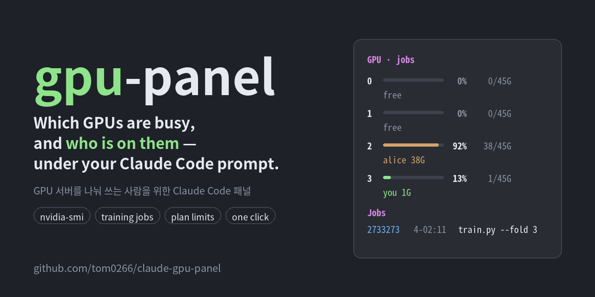
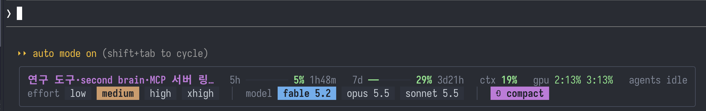

# gpu-panel



[](LICENSE)


A Claude Code panel for people who share a GPU server.

One line under your prompt shows which GPUs are busy, how many training jobs you
have running, and how much of your plan is left. Click `gpu` and a pane opens
with every card, who is using it, and your jobs with their elapsed time.

[한국어](README.ko.md)



A real session. Cards 2 and 3 are busy at 13%; the other two are free and stay out of the line.

Most panels like this live above the prompt and show plan usage. This one sits
below the prompt, next to the hint line, and its first concern is the machine
you are sharing with other people.

## What it shows

**The line under your prompt**

| Field | Meaning |
|---|---|
| session name | from `/rename`, or the auto-generated title |
| `5h` `7d` | plan usage with a bar and the time until reset |
| `ctx` | how full the context window is |
| `gpu` | busy cards only, as `index:utilization` or `index:memory`; `free` when none |
| `job` | how many of your watched training jobs are running; hidden at zero |
| `agents` | running subagents by model, plus done and failed counts |
| buttons | switch effort, switch model, run `/compact` |

The model buttons learn their version numbers from models you actually use, so
`opus` becomes `opus 5.5` once you have run it, and the version is remembered
between sessions. Nothing is hardcoded, so it does not go stale.

Below 110 columns the panel drops its border, bars and labels and fits in two
lines. Three cards wide in a split pane still works.

**The `gpu` pane** — click the `gpu` field or run `/gpu`

```
  GPU
  0 ━━━━━━━━     0%   0/45G 31°C
    free
  2 ━            15%   1/48G 54°C
    you 1G, alice 22G

  Jobs
  2733273  4-02:11:08  python train.py --fold 3
```

Every card with its utilization, memory, temperature, and **the account using
it**, so you can see at a glance whether the card you want is free or someone
else's run is on it. Under that, your own watched jobs with PID and elapsed
time. The pane refreshes every ten seconds while it is open, and runs no queries
at all while it is closed.

## Install

Needs Claude Code 2.1.287 or later.

```bash
claude plugin marketplace add tom0266/claude-gpu-panel
claude plugin install gpu-panel@claude-gpu-panel
```

Then `/reload-plugins` in an open session, or start a new one.

GPU and job fields appear only when the machine can produce them:

- **GPU** needs `nvidia-smi` on your `PATH`. Without it the field is hidden, so
  the panel still works on a laptop.
- **Jobs** needs `~/.claude/statusline-jobs.txt`, one pattern per line. A line
  matches if it appears anywhere in a process's command. Blank lines and lines
  starting with `#` are ignored.

  ```
  # ~/.claude/statusline-jobs.txt
  train.py
  finetune
  optuna
  ```

  Only your own processes are counted, and identical command lines are counted
  once.

## Commands

| | |
|---|---|
| `/gpu` | open the GPU and jobs pane |

Everything else is a click.

## What it costs

The panel reads plan usage and context from events Claude Code already raises,
so those are free. On a timer it runs `nvidia-smi` and `ps` every ten seconds,
and greps the session transcript for its title every thirty. It makes no network
requests and calls no model.

## Configuration

Colors are a single constant near the top of `hooks/register.tsx`, named `C`.
Each entry is a hex color or a theme key. Change them there and reinstall.

Thresholds for the usage toast are `THRESHOLD` in the same file: 80% for the
five-hour window, 70% for the seven-day one. Each window warns once per reset.

## Limits

- Drawn in the terminal and the Desktop app's Code tab. `claude -p` and cloud
  sessions run the hooks but draw nothing.
- The GPU pane shows accounts, not people. On a machine where everyone shares
  one account it tells you less.
- Effort is tracked by watching `/effort` and the panel's own buttons. Claude
  Code does not expose the current level, so if it is changed another way the
  highlight can fall out of step until the next change.

## License

MIT
